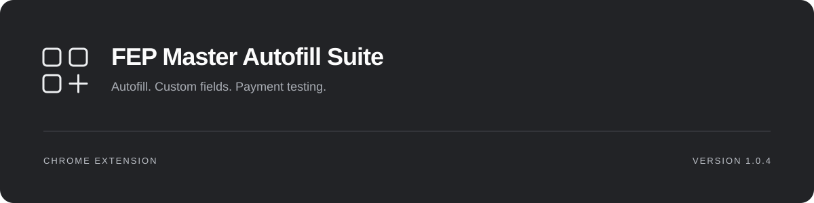
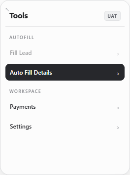
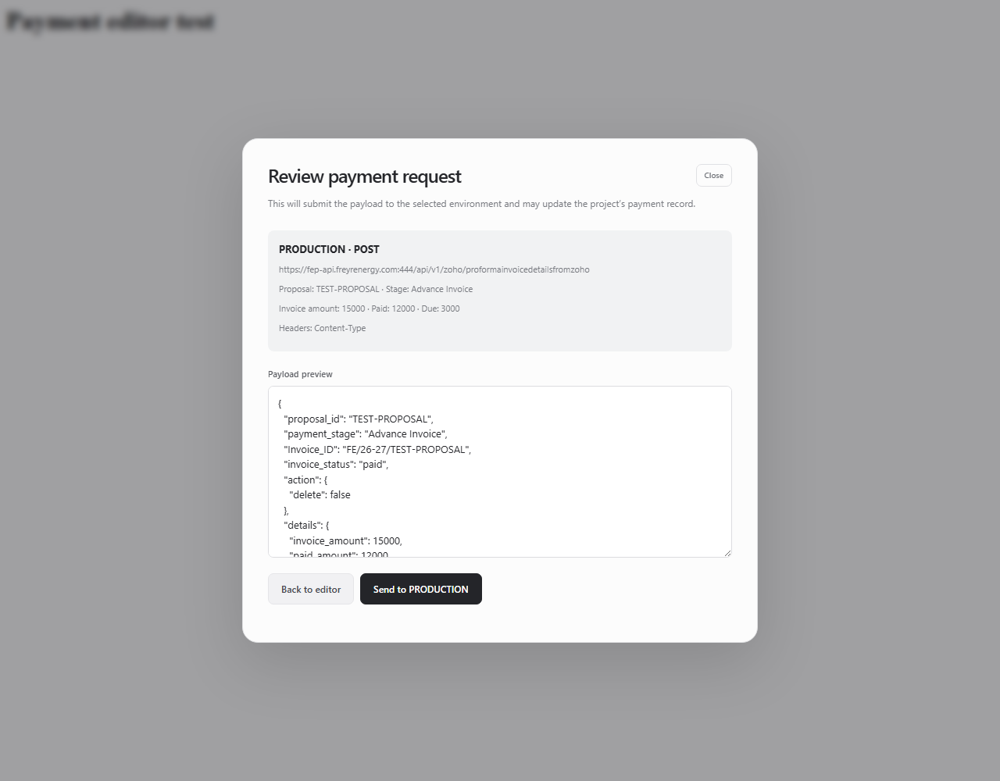

<p align="center"></p>

<p align="center">
  <a href="https://github.com/rahulcv1003/fepautomation/releases/tag/v1.0.4">Version 1.0.4</a> ·
  <a href="https://github.com/rahulcv1003/fepautomation/releases/latest">Download</a> ·
  <a href="CHANGELOG.md">What’s new</a> ·
  <a href="https://github.com/rahulcv1003/fepautomation/issues/new?template=bug_report.yml">Feedback</a>
</p>

**Spend less time filling FEP forms.** FEP Master Autofill Suite is a Chrome Manifest V3 extension for repetitive FEP workflows. Fill leads, proposals, and POs; define your own field values; and prepare payment API requests without switching to Postman.

## Download and install

**[Download FEP Master Autofill Suite 1.0.4](https://github.com/rahulcv1003/fepautomation/releases/download/v1.0.4/fep-master-autofill-suite-1.0.4.zip)**

1. Download the named extension ZIP from [Releases](https://github.com/rahulcv1003/fepautomation/releases/latest).
2. Extract it into a folder you intend to keep.
3. Open `chrome://extensions/` and enable **Developer mode**.
4. Choose **Load unpacked** and select the extracted folder containing `manifest.json`.
5. Open a supported FEP page and use the small graphite launcher.

No Node.js, build step, or Tampermonkey is needed to use the download. Keep the extracted folder in place while the extension is installed. The release ZIP also serves as the Chrome Web Store upload package.

To update an unpacked installation, replace its extracted runtime files, click **Reload** on the extension card, then refresh FEP. Custom rules and settings remain in extension-local storage when reloading the same installation. Uninstalling the extension removes that data.

## A focused workspace

| Tool | What it does |
|---|---|
| **Fill Lead** | Fill the open Add Lead form with generated defaults and matching saved rules. |
| **Auto Fill Details** | Select the appropriate autofill routine for the current supported FEP page. |
| **Finance / Non Finance** | Use the relevant PO flow on Generate PO pages. |
| **Payments** | Import, edit, review, and submit payment requests to a selected FEP API environment. |
| **Settings → Custom Field Builder** | Pick fields and save values for a page pattern and environment. |
| **Settings → Feedback & feature requests** | Prepare a GitHub bug report, feature suggestion, or general feedback. |
| **Settings** | Set your autofill name, review activity statistics, and reopen What’s New. |

The launcher is draggable. Resize its expanded panel from the upper-left corner, or focus the resize handle and use arrow keys. Double-click the handle to reset. Your preferred size is remembered.

<table>
  <tr><th>Compact tools</th><th>Payment review</th></tr>
  <tr>
    <td align="center"></td>
    <td align="center"></td>
  </tr>
</table>

*Screenshots use test fixtures and simulated responses, not live customer records.*

## Custom fields that follow the workflow

1. Open the form, then choose **Settings → Custom Field Builder**.
2. Choose **Pick a field on this page** and click the field.
3. Enter the value, choose the environment, review the page pattern, and save.
4. Use **Test** for one rule or **Fill saved fields** for matching enabled rules.

Saved values replace defaults **at each field’s turn**, before dependent fields are filled. For example, a saved “3 Phase” selection is applied before the system-size and inverter-phase steps. Newly added custom fields enter before the next built-in field below them in page order. A rejected override stops the run with an explanation.

For dropdowns, enter the **exact displayed option text**, including spelling and capitalization. Fields are matched using stable attributes or labels, with an occurrence check when needed. Numeric, MongoDB, and UUID path segments default to `*`; review the pattern if several forms share a route. Query parameters are ignored.

Supported: text, numbers, email, textarea, native date fields, native and Ant Design single-select dropdowns, checkboxes, and radio options. Multi-selects, file inputs, password fields, and read-only date widgets are not supported by the builder. Rules can be edited, tested, enabled, disabled, or deleted.

## Payments, without leaving FEP

Open **Payments** from the launcher or **Pay Advance Payment** on the PO confirmation page.

- Start from the prefilled sample payload or import a Postman cURL, including JSON comments.
- Edit nested values; numbers, booleans, and unset optional fields are handled automatically.
- Choose **UAT, QA, staging, or production**. The endpoint follows the selected environment.
- Review the proposal ID, amounts, headers, and complete payload before pressing **Send**.
- Inspect the HTTP status, elapsed time, and response body, or export the edited cURL.
- Use **Reset to sample** to restore the sample values without changing the environment.

The default payload includes sample identifiers, June 30 timestamps, amounts, links, and transaction details. Update these values for the intended request. Drafts, optional credentials, and the last response stay in the page’s memory until refresh. Requests are limited to the configured payment endpoints; automatic retries are not performed. If the connection fails, check the project’s payment record before resending because the result may be unknown.

## Environments and workflow support

| Environment | Main frontend | Payment API host on port 444 |
|---|---|---|
| UAT | `uat-fep.freyrenergy.com` | `uat-fep-api.freyrenergy.com` |
| QA | `qa-fep.freyrenergy.com` | `qa-fep-api.freyrenergy.com` |
| Staging | `stg-fep.freyrenergy.com` | `stg-fep-api.freyrenergy.com` |
| Production | `fep.freyrenergy.com` | `fep-api.freyrenergy.com` |

Payment requests use `/api/v1/zoho/proformainvoicedetailsfromzoho`. The legacy QA console and existing QA/staging API page matches remain supported. UAT and production GraphQL actions retain their configured Sunpro backends. Localhost and `127.0.0.1` form pages are supported for development, with direct API actions disabled.

Existing tools also cover supported document, survey, installation, dispatch, and liaising workflows, plus OTP assistance on configured login pages. Availability depends on the current FEP page and visible fields. Some existing workflow actions submit data or advance the page; review the action you choose.

## Feedback and feature requests

Use **Settings → Feedback & feature requests**, or open the [GitHub form](https://github.com/rahulcv1003/fepautomation/issues/new?template=bug_report.yml). Reports are public and assigned to [@rahulcv1003](https://github.com/rahulcv1003); notification delivery follows GitHub preferences. A GitHub account is required to submit.

The form adds only the extension version, environment hostname, browser family, and the text you provide. It does not automatically include project IDs, saved values, payment payloads, or responses. Review your report and remove private information before submitting.

## Privacy and permissions

Profile preferences, field rules, statistics, and panel dimensions stay in Chrome local extension storage. FEP actions communicate with the configured FEP services; feedback is submitted through GitHub. There are no analytics or advertising scripts. Some workflow diagnostics are written to the browser developer console.

Read the [privacy notes](docs/PRIVACY.md) and [permission explanations](docs/PERMISSIONS.md) for the details.

## Development

Requirements: Node.js 22+ and Playwright’s Chromium for browser tests.

```sh
npm ci
npx playwright install chromium
npm run check
npm test
npm run package
```

| Command | Purpose |
|---|---|
| `npm run check` | Validate runtime syntax, versions, manifest references, and icons. |
| `npm test` | Run custom-field, workflow, dropdown, numeric, and payment tests against fixtures. |
| `npm run package` | Build the runtime-only extension ZIP and SHA-256 checksum under `release/`. |
| `npm run icons` | Regenerate PNG icons from the shared vector mark. |

Tests use isolated browser contexts, fixture pages, and simulated payment responses. They do not submit live payments or use your personal browser profile. The repository root is itself loadable as an unpacked extension; a production download contains only the required runtime files.

## Repository guide

| Path | Contents |
|---|---|
| `manifest.json`, `content.js`, `ui.css` | Chrome configuration, FEP workflows, and scoped interface styles. |
| `custom-tools.js` | Field picker, saved-rule engine, and feedback dialogs. |
| `payment-tools.js`, `background.js` | Payment editor, cURL parsing, and validated request relay. |
| `interceptor.js`, `otp-listener.js` | Login-response and OTP assistance. |
| `icons/` | Vector mark and packaged PNG icons. |
| `tests/` | Browser and worker regression tests. |
| `scripts/` | Release validation and ZIP packaging. |
| `docs/` | Architecture, privacy, permissions, release guide, and screenshots. |
| `tools/legacy/` | Earlier icon-generation utilities retained for reference. |

## Documentation

- [Changelog](CHANGELOG.md)
- [Architecture overview](docs/ARCHITECTURE.md)
- [Privacy](docs/PRIVACY.md)
- [Permissions](docs/PERMISSIONS.md)
- [Release and manual acceptance guide](docs/RELEASE.md)
- [Contributing](CONTRIBUTING.md)

Maintained by [Rahul / @rahulcv1003](https://github.com/rahulcv1003). Source is available for inspection; no open-source license has been assigned.
